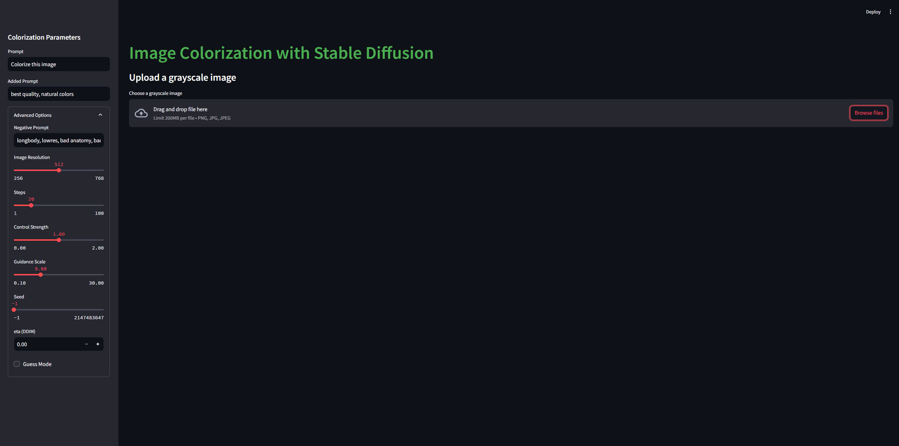

# Colorization for Grayscale Images

A web app that adds natural colors to black-and-white photos. Under the hood it uses a ControlNet on top of Stable Diffusion 2.1, fine-tuned for colorization: the grayscale photo guides the image structure, a short text prompt (for example "Colorize this image") guides the result, and the original brightness of the photo is kept so that its details are preserved. A FastAPI backend runs the model and exposes one HTTP endpoint, and a Streamlit frontend lets you upload a photo, tune the settings and download the result. The model setup, the training list and the inference steps are based on the open-source [ColorizeNet](https://github.com/rensortino/ColorizeNet) project (see [Acknowledgments](#acknowledgments)).



> **Note:** the fine-tuned model checkpoint is **not included** in this repository. You need your own checkpoint to run the app. See [Get a model checkpoint](#3-get-a-model-checkpoint).

## Contents

- [How it works](#how-it-works)
- [Project structure](#project-structure)
- [Setup](#setup)
- [Configuration](#configuration)
- [API documentation](#api-documentation)
- [Training](#training)
- [Limitations](#limitations)
- [Team & my role](#team--my-role)
- [Acknowledgments](#acknowledgments)
- [License](#license)

## How it works

1. **Input.** The uploaded image is converted to 3-channel RGB and resized so that its shorter side equals `image_resolution` (default 512). Both sides are rounded to a multiple of 64.
2. **ControlNet conditioning.** The grayscale image is the ControlNet "hint" (control image). ControlNet is a trainable copy of the Stable Diffusion 2.1 UNet encoder; it reads the grayscale image and feeds its features into the frozen Stable Diffusion UNet. The text prompt is encoded with the OpenCLIP ViT-H-14 text encoder used by Stable Diffusion 2.1.
3. **Sampling.** The model generates a color image with the DDIM sampler (default 20 steps) and classifier-free guidance (default scale 9.0) with a negative prompt.
4. **Keep the original details.** The input and the generated image are converted to the LAB color space. The result keeps the **L (lightness) channel of the input** and takes only the **a/b (color) channels from the generated image**. The model therefore only decides the colors; edges and textures come from the original photo.

These inference steps, including the LAB color transfer, follow the demo script of [ColorizeNet](https://github.com/rensortino/ColorizeNet). See [Acknowledgments](#acknowledgments) for everything this project reuses.

**Training data.** The training list `backend/src/data/training/prompts.json` was taken unchanged from [ColorizeNet](https://github.com/rensortino/ColorizeNet); the team did not create it. It has 118,287 entries, one per image of the COCO 2017 training set (`train2017`, file names are COCO image IDs such as `000000129852.jpg`). Each entry pairs a color image with one of 10 short prompts such as "Colorize this grayscale image". During training the dataset loader makes the grayscale input from the color image with OpenCV, so every example is a grayscale/color pair. The Stable Diffusion 2.1 weights stay locked (`sd_locked = True`) and only the ControlNet part is trained. See [Training](#training).

## Project structure

```text
.
├── backend/src/
│   ├── main.py                 # FastAPI app: POST /api/colorize (inference steps adapted from ColorizeNet)
│   ├── train.py                # ControlNet fine-tuning script (adapted from ColorizeNet)
│   ├── data/dataset.py         # Dataset: color image -> (grayscale hint, color target, prompt) (adapted from ColorizeNet)
│   ├── data/training/prompts.json  # Training list: COCO train2017 file names + prompts (from ColorizeNet)
│   ├── models/cldm_v21.yaml    # Model config: ControlNet + Stable Diffusion 2.1 (adapted from ColorizeNet)
│   ├── utils/                  # Helpers: resize, LAB color transfer, DDIM sampler, model loading (from ColorizeNet)
│   ├── cldm/                   # ControlNet code (from lllyasviel/ControlNet)
│   ├── ldm/                    # Stable Diffusion code (from lllyasviel/ControlNet / Stability AI)
│   └── config.py, share.py     # Training options, e.g. memory saving (from ColorizeNet)
├── frontend/app.py             # Streamlit UI
├── images/ui.jpg               # UI screenshot
├── licenses/Apache-2.0.txt     # License text for the ColorizeNet and ControlNet code
├── THIRD_PARTY_NOTICES.md      # Which files come from which project, and under which license
└── requirements.txt            # Python dependencies (full environment list)
```

"From" means the file was copied without changes; "adapted from" means the team changed it. [`THIRD_PARTY_NOTICES.md`](THIRD_PARTY_NOTICES.md) lists every file.

An earlier, exploratory data pipeline is kept on the [`convert_data`](https://github.com/Qcymaq/Colorization-for-grayscale-images/tree/convert_data) branch. It downloads COCO from Hugging Face (`detection-datasets/coco`), saves grayscale and color copies, and writes a prompt file with its own set of 10 prompts. It was **not** used to build the final training list: `prompts.json` above comes from ColorizeNet.

## Setup

### Prerequisites

- An **NVIDIA GPU with CUDA**. The backend moves the model to the GPU with `.cuda()` and has no CPU fallback.
- **Python 3.8** is what the original environment used (the bytecode files that were committed earlier were built with CPython 3.8). Newer Python versions may fail to install some of the pinned packages.
- **Git**, because one dependency (`open-clip-torch`) is installed from a Git commit.
- Internet access on the first start: the OpenCLIP ViT-H-14 text encoder weights are downloaded automatically when the model is created.

### 1. Clone the repository

```bash
git clone https://github.com/Qcymaq/Colorization-for-grayscale-images.git
cd Colorization-for-grayscale-images
```

### 2. Create a virtual environment and install dependencies

```bash
python -m venv venv
source venv/bin/activate        # On Windows: venv\Scripts\activate
pip install -r requirements.txt
```

Notes about `requirements.txt`:

- It is a full list of the original machine's environment, so it also contains packages the app does not import.
- `torch` and `torchvision` are not pinned, while `torchaudio==2.4.1`, `xformers==0.0.28.post1`, `triton==3.0.0` and the `nvidia-*-cu12` packages are. If pip picks a mismatching version, install the PyTorch build that matches your CUDA version from [pytorch.org](https://pytorch.org/get-started/locally/) first, then run `pip install -r requirements.txt` again.
- `triton` and the `nvidia-*` packages target Linux. `mkl-fft`, `mkl-random` and `mkl-service` usually come from conda. If one of these lines fails to install on your system, it is not imported by the app code; you can remove that line and try again.

### 3. Get a model checkpoint

The fine-tuned checkpoint is **not** in this repository. You need a ControlNet + Stable Diffusion 2.1 checkpoint (`.ckpt` or `.safetensors`) that matches `backend/src/models/cldm_v21.yaml`, for example one you trained yourself with [`train.py`](#training).

By default the backend loads:

```text
backend/src/checkpoints/epoch=2-step=44357.ckpt
```

Either put your file at that path, or point the backend at any other file with the `CHECKPOINT_PATH` environment variable:

```bash
export CHECKPOINT_PATH=/path/to/your/colorization.ckpt          # Linux / macOS
# $env:CHECKPOINT_PATH = "C:\path\to\your\colorization.ckpt"     # Windows PowerShell
```

The model is loaded on the **first request**, not when the server starts, and then stays in memory. A wrong path shows up as an error on that first request. On a new machine the first request also downloads the OpenCLIP text encoder weights (several gigabytes), so it can take much longer than later requests.

### 4. Start the backend

Run this from the **repository root** (the model config path is relative to it):

```bash
python backend/src/main.py
```

The API runs on `http://localhost:8000`. Interactive API docs (Swagger UI) are at `http://localhost:8000/docs`.

### 5. Start the frontend

In a second terminal (with the same virtual environment):

```bash
streamlit run frontend/app.py
```

Open `http://localhost:8501`, upload a grayscale image, adjust the settings in the sidebar and click **Colorize Image**. You can then download the result as a PNG.

> **First run:** the UI waits at most `REQUEST_TIMEOUT` seconds (default 300) for an answer. The very first request downloads the OpenCLIP weights and loads the checkpoint, which can take longer than that. If the UI says the backend did not answer in time, the backend may still finish the job, but the result is lost. To avoid this, send one warm-up request before you use the UI (curl waits as long as needed):
>
> ```bash
> curl -X POST http://localhost:8000/api/colorize -F "file=@path/to/any_image.jpg" --output warmup.png
> ```
>
> Or start the frontend with a longer timeout, for example `REQUEST_TIMEOUT=1800 streamlit run frontend/app.py`.

## Configuration

All settings are optional environment variables.

| Variable | Used by | Default | Meaning |
|---|---|---|---|
| `CHECKPOINT_PATH` | backend | `backend/src/checkpoints/epoch=2-step=44357.ckpt` | Path to the model checkpoint. Relative paths are resolved from the directory you start the server in. |
| `BACKEND_URL` | frontend | `http://localhost:8000` | Base URL of the backend API. |
| `REQUEST_TIMEOUT` | frontend | `300` | Seconds to wait for the backend. The first request also downloads the OpenCLIP weights and loads the model, so raise this (for example to `1800`) or send a warm-up request first. Must be a positive number; an invalid value falls back to `300` and the UI shows a warning. |
| `BACKGROUND_IMAGE` | frontend | `image.jpg` in the repository root | Optional page background image. If the file does not exist, the page has no background image. |

## API documentation

### `POST /api/colorize`

Colorizes one image. The request is `multipart/form-data`. Only `file` is required; every other field has a default.

| Field | Type | Default | Description |
|---|---|---|---|
| `file` | file | **required** | The image to colorize (any format Pillow can open, e.g. PNG or JPEG). Color images also work, but the model was trained on grayscale input. |
| `prompt` | string | `Colorize this image` | Main text prompt. |
| `a_prompt` | string | `best quality, natural colors` | Extra text added after the prompt (`prompt + ", " + a_prompt`). |
| `n_prompt` | string | `longbody, lowres, bad anatomy, bad hands, missing fingers, extra digit, fewer digits, cropped, worst quality, low quality` | Negative prompt (what to avoid). |
| `num_samples` | integer | `1` | Number of images generated in one batch. **Only the first image is returned**, so values above 1 only add processing time. |
| `image_resolution` | integer | `512` | Target length of the shorter image side. Both sides are rounded to a multiple of 64. The UI offers 256 to 768. |
| `ddim_steps` | integer | `20` | Number of DDIM sampling steps. More steps are slower. The UI offers 1 to 100. |
| `guess_mode` | boolean | `false` | ControlNet "guess mode": the negative branch runs without the control image and the control strength is lower for the shallow layers. |
| `strength` | float | `1.0` | Control strength: how strongly the grayscale image guides the model. The UI offers 0.0 to 2.0. |
| `scale` | float | `9.0` | Classifier-free guidance scale: how strongly the prompt is followed. The UI offers 0.1 to 30.0. |
| `seed` | integer | `-1` | Random seed for reproducible results. `-1` picks a random seed between 0 and 65535. |
| `eta` | float | `0.0` | DDIM eta. `0.0` gives deterministic sampling for a fixed seed. |

The API does not check value ranges; the ranges above are the limits used by the Streamlit UI.

**Success response:** `200 OK` with the colorized image as `image/png`. Its size is the resized input size (shorter side about `image_resolution`), not the original upload size.

**Error responses** (JSON body `{"detail": "..."}`):

| Status | When |
|---|---|
| `400` | The uploaded file is not a readable image (`Invalid image file: ...`). |
| `422` | `file` is missing or a field has the wrong type (FastAPI validation error). |
| `500` | Colorization failed (`Error during colorization: ...`), for example the checkpoint file is missing or no CUDA GPU is available. |

**Example with curl:**

```bash
curl -X POST http://localhost:8000/api/colorize \
  -F "file=@path/to/grayscale.jpg" \
  -F "prompt=Colorize this image" \
  -F "a_prompt=best quality, natural colors" \
  -F "image_resolution=512" \
  -F "ddim_steps=20" \
  -F "strength=1.0" \
  -F "scale=9.0" \
  -F "seed=42" \
  --output colorized.png
```

**Example with Python:**

```python
import requests

with open("grayscale.jpg", "rb") as f:
    response = requests.post(
        "http://localhost:8000/api/colorize",
        files={"file": f},
        data={"prompt": "Colorize this image", "seed": 42},
        timeout=300,
    )
response.raise_for_status()
with open("colorized.png", "wb") as out:
    out.write(response.content)
```

### `GET /`

Returns a short welcome message as JSON. Useful as a quick "is the server up?" check.

## Training

`backend/src/train.py` fine-tunes the ControlNet with PyTorch Lightning. Its paths are relative to `backend/src`, so run it from there:

```bash
cd backend/src
python train.py
```

What it expects:

- **Images:** the COCO 2017 training images in `backend/src/data/training/target/` (they are not included in this repository). The list of file names and prompts is `backend/src/data/training/prompts.json` (taken from ColorizeNet). Only the color images are needed; the grayscale input is created on the fly.
- **Starting weights:** `backend/src/checkpoints/epoch=2-step=44357.ckpt` (`resume_path` in `train.py`). To start from the original Stable Diffusion 2.1 weights instead, create an initial ControlNet checkpoint with `tool_add_control_sd21.py` from [lllyasviel/ControlNet](https://github.com/lllyasviel/ControlNet) and set `resume_path` to it.
- **Settings in `train.py`:** batch size 4, learning rate 1e-5, Stable Diffusion weights locked, 32-bit precision, 1 GPU, 20 data loader workers (lower `num_workers` on machines with fewer CPU cores). Sample images are written to `image_log/` every 300 batches. Set `save_memory = True` in `backend/src/config.py` to enable sliced attention if GPU memory is short.

## Limitations

- An NVIDIA GPU is required; there is no CPU mode.
- The output resolution follows `image_resolution`, not the size of the uploaded file.
- The API returns only one image per request, even when `num_samples` is higher.
- The backend listens on all network interfaces (`0.0.0.0:8000`), allows requests from any origin (CORS `*`) and has no authentication. Run it on your own machine or behind a firewall, not directly on the public internet.

## Team & my role

This was a university course project (January to March 2025) built by a team of 4 to 5 students. I, **Mai Anh Quan** ([@Qcymaq](https://github.com/Qcymaq)), was the team lead.

The project builds on open-source work. The model code, the training list and several helper files come from [ColorizeNet](https://github.com/rensortino/ColorizeNet) and [ControlNet](https://github.com/lllyasviel/ControlNet); see [Acknowledgments](#acknowledgments) and [`THIRD_PARTY_NOTICES.md`](THIRD_PARTY_NOTICES.md) for the exact files.

According to the Git history, I wrote:

- an early, exploratory COCO data-preparation pipeline (`converted_coco.py` and `dataset/prompts_create.py` on the `convert_data` branch); it was not used for the final training list, which came from ColorizeNet,
- the FastAPI `/api/colorize` inference endpoint (the sampling steps inside it follow ColorizeNet's demo script),
- the Streamlit UI (its settings and slider ranges mirror ColorizeNet's Gradio demo),
- the model cache that keeps the model in memory between requests.

My teammates also committed code, including the training code (adapted from ColorizeNet), the split into a separate server and client, and the UI styling. See the commit history for individual contributions.

Contact: quanmaianh.work@gmail.com · GitHub [@Qcymaq](https://github.com/Qcymaq) · LinkedIn [maq159](https://www.linkedin.com/in/maq159)

## Acknowledgments

- **ControlNet** by Lvmin Zhang: [lllyasviel/ControlNet](https://github.com/lllyasviel/ControlNet). The code in `backend/src/cldm/` and `backend/src/ldm/` comes from this repository, and the training setup follows its approach.
- **Stable Diffusion 2.1** by Stability AI: [Stability-AI/stablediffusion](https://github.com/Stability-AI/stablediffusion). It is the base model, and the `ldm/` code originally comes from this repository.
- **OpenCLIP**: [mlfoundations/open_clip](https://github.com/mlfoundations/open_clip), the text encoder used by Stable Diffusion 2.1.
- **ColorizeNet** by rensortino: [rensortino/ColorizeNet](https://github.com/rensortino/ColorizeNet) (Apache-2.0), a ControlNet on Stable Diffusion 2.1 for image colorization. This project is largely based on it:
  - **Taken unchanged:** `backend/src/utils/` (`data.py`, `ddim.py`, `model.py`, `diffusion.py`), `backend/src/config.py`, `backend/src/share.py` and the training list `backend/src/data/training/prompts.json`.
  - **Adapted:** `backend/src/models/cldm_v21.yaml` (`hint_channels` set to 3), `backend/src/train.py`, `backend/src/data/dataset.py` (from ColorizeNet's `colorization_dataset.py`), and the inference steps in `process()` in `backend/src/main.py` (from ColorizeNet's `gradio_colorization.py`: the default added and negative prompts, the guess-mode control scales and the LAB color transfer).
- **COCO dataset**: [cocodataset.org](https://cocodataset.org/). The training images come from the COCO 2017 training set and are subject to the COCO terms of use.

## License

No license has been chosen yet for the original code in this repository. (An earlier version of this README said MIT, but a LICENSE file was never added.) Until a LICENSE file is added, default copyright rules apply (all rights reserved), so please contact the team if you want to reuse the code.

Code, data and models from other projects keep their own licenses. [`THIRD_PARTY_NOTICES.md`](THIRD_PARTY_NOTICES.md) lists the files, and the Apache-2.0 text is in [`licenses/Apache-2.0.txt`](licenses/Apache-2.0.txt). Please check the upstream repositories for the exact terms:

- Files from [rensortino/ColorizeNet](https://github.com/rensortino/ColorizeNet) (Apache-2.0): `backend/src/utils/`, `backend/src/config.py`, `backend/src/share.py` and `backend/src/data/training/prompts.json` (unchanged), and `backend/src/models/cldm_v21.yaml`, `backend/src/train.py`, `backend/src/data/dataset.py` and the inference steps in `backend/src/main.py` (adapted).
- `backend/src/cldm/` and `backend/src/ldm/`: [lllyasviel/ControlNet](https://github.com/lllyasviel/ControlNet) (Apache-2.0), which builds on [Stability-AI/stablediffusion](https://github.com/Stability-AI/stablediffusion) (MIT).
- Stable Diffusion 2.1 model weights: CreativeML Open RAIL++-M license.
